```{=html}
<style>
code:not(pre code) {
  background-color: #3e3f40;
  color: #0066cc;
  padding: 2px 5px;
  border-radius: 3px;
}
</style>
```


# Dane

Zbiór danych pochodzi z Kaggle: <https://www.kaggle.com/datasets/guanhaopeng/uk-used-car-market/data>.

Zawiera informacje o wszystkich ogłoszeniach jednego z największych portali samochodów używanych w Wielkiej Brytanii zebranych w październiku 2022 roku.

Oryginalnie ma 818456 wierszy oraz 32 kolumny.

Kolumny zbioru danych:

- `X` – numer obserwacji (wiersza)

- `make` – marka producenta pojazdu

- `model` – nazwa modelu

- `variant` – wariant (dodatkowa informacja o modelu)

- `car_price` – cena samochodu wyrażona w funtach szterlingach \[GBP\]

- `car_badges` – dodatkowe informacje o ogłoszeniu, głównie związane z ceną, możliwością finansowania, kategorią ubezpieczenia, itp.

- `car_title` – nazwa pojazdu, zazwyczaj w formie marka + model

- `car_sub_title` – dodatkowe informacje o specyfikacji, pojazdu, np. o silniku, wyposażeniu itp.

- `car_attention_grabber` – informacje zawarte w ogłoszeniu służące do przykucia uwagi klienta

- `car_specs` – zbiór głównych cech technicznych samochodu takich jak: rok produkcji, rejestracja, typ nadwozia, przebieg, silnik itd.

- `car_seller` – nazwa lub typ sprzedawcy

- `car_seller_rating` – ocena sprzedawcy (od 1 do 5)

- `car_seller_location` – lokalizacja sprzedawcy

- `year` – rok produkcji

- `reg` – informacja o przybliżonej dacie pierwszej rejestracji pojazdu zapisana przy użyciu litery lub dwóch cyfr

- `body_type` – typ nadwozia

- `miles` – przebieg samochodu w milach lądowych angielskich \[mi\]

- `engine_vol` – pojemność silnika w litrach

- `engine_size` – moc jednostki napędowej

- `engine_size_unit` – jednostka mocy silnika (\[BHP\] lub \[PS\])

- `transmission` – rodzaj skrzyni biegów (automatyczna lub manualna)

- `feul_type` – rodzaj paliwa (w oryginalnej nazwie zawiera błąd typograficzny, który został naprawiony po wczytaniu danych)

- `num_owner` – liczba właścicieli pojazdu

- `ulez` – skrót od \\textit{Ultra Low Emission Zone} (oznacza strefę w Londynie, gdzie pojazdy muszą spełniać standardy emisji spalin albo trzeba zapłacić za wjazd, zazwyczaj wymogi spełniają auta benzynowe zarejestrowane po 2006 roku i z silnikiem diesla po 2015 roku); przyjmuje wartość 1 (pojazd spełnia wymogi strefy) lub 0 (nie spełnia wymogów)

- `full_service` – określa, czy pojazd posiada pełną dokumentację wszystkich wykonanych przeglądów/czynności serwisowych; jeśli tak, przyjmuje wartość 1, a w przeciwnym razie 0

- `part_service` – określa, czy pojazd posiada częściową dokumentację wykonanych przeglądów/czynności serwisowych; jeśli tak, przyjmuje wartość 1, w przeciwnym razie 0

- `part_warranty` – określa posiadanie przez pojazd pełnej gwarancji producenta; w przypadku pozytywnym przyjmuje wartość 1, a w negatywnym 0

- `full_dealership` – informuje o pełnej historii serwisowej pojazdu w Autoryzowanej Stacji Obsługi (ASO) danej marki; przyjmuje wartość 1, gdy pojazd odbył wszystkie wizyty serwisowe w ASO, natomiast w przeciwnym razie przyjmuje wartość 0

- `first_year_road_tax` – dotyczy opłaty za dopuszczenie auta do ruchu, która zależy od emisji $\text{CO}_2$ lub rodzaju silnika, zwykle uregulowana przy zakupie; wartość 1 występuje w przypadku uwzględnionej opłaty (w cenie), natomiast 0 w przeciwnym wypadku

- `brand_new` – określa stan pojazdu; przyjmuje wartość 1, gdy samochód jest nowy (nieużywany), natomiast 0, gdy jest używany

- `finance_available` – określa możliwość zakupu na raty/w formie kredytu/leasingu; przyjmuje wartość 1, gdy dopuszczalna jest taka opcja bądź 0 w przeciwnym razie

- `discounted` – określa, czy pojazd jest objęty promocją lub zniżką; przyjmuje wartość 1 w pozytywnym przypadku, zaś 0 w negatywnym

## Problem predykcyjny – Regresja

Zmienną objaśnianą (zależną) wykorzystaną podczas modelowania będzie kolumna `car_price`. Przedstawia ona cenę pojazdu podaną w brytyjskich funtach szterlingach \[GBP\] i to właśnie jej wartości (ceny samochodów) będą prognozowane za pomocą wybranych modeli regresyjnych.

## Literatura📜

- Raghav, Shashwat Singh and R, Bharath and T, Bharath and Hegde, Ravi and Ramesh, Sohan, *Used Car Price Prediction Using Machine Learning* – International Journal for Research in Applied Science and Engineering Technology, vol. 11, 1176-1180, 2023

  Wyniki na zbiorze testowym (800 obserwacji):

  - Regresja liniowa: $R^2 = 0,81$

  - Random Forest: $R^2 = 0,87$

- Svenja Bergmann, Stefan Feuerriegel, *Machine learning for predicting used car resale prices using granular vehicle equipment information* – Expert Systems with Applications, vol. 263, 2025

  Wyniki na zbiorze testowym (92 tys. obserwacji + informacje o wyposażeniu):

  - LightGBM: $MAE = 3,4\,\%$

- Msiza, Zenzele and Pius, Owolawi, *Advancing Used Car Price Prediction in South Africa: An Empirical Examination of Machine Learning Techniques* – International Conference on Artificial Intelligence and its Applications, vol. 2023, 189-196, 2023

  Wyniki na zbiorze testowym (3040 obserwacji):

  - Random Forest: $R^2 = 0,988$

  - Decision Tree: $R^2 = 0,986$

  - KNN: $R^2 = 0,786$

- Kadir, Md and Nassar, Benazir and Alam, S. and Ahmed, Saad and Syfullah, Md. Khalid, *Car Price Prediction: A Comparative Study of Machine Learning and Deep Learning Approaches* –International Conference on Electrical, Computer and Communication Engineering, 1-6, 2025

  Wyniki na zbiorze testowym:

  - Random Forest: $R^2 = 0,58$

  - RNN: $R^2 = 0,67$

  - LSTM: $R^2 = 0,63$

  - DNN: $R^2 = 0,66$

- Kang, Jo and Parekh, Heta and Ramdas, Priya and Lee, Seongwon and Woo, Jongwook, *Comparing Regression Models Predicting the Price of Used Cars in Big Data* – International Conference on Consumer Electronics-Asia (ICCE-Asia), 1-4, 2022

  Wyniki na zbiorze testowym (ponad 3 miliony obserwacji):

  - Factorized Machine Learning: $R^2 = 0,651$

  - Random Forest: $R^2 = 0,825$

  - Gradient Boost Decision Tree: $R^2 = 0,85$

### Braki danych

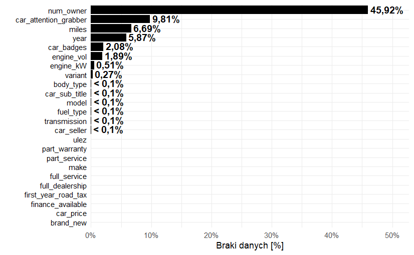

# Czyszczenie danych


## Usuwanie zbędnych lub powielających informacje kolumn

Ze zbioru danych na podstawie wiedzy dziedzinowej wyeliminowana następujące kolumny ze względu na brak ich potencjału predykcyjnego:

- `X`

- `car_title`

- `car_specs`

- `car_seller_rating`

- `car_seller_location`

- `reg`

- `discounted`

Następnie zmodyfikowano typy danych dla pozostałych kolumn a angielskie nazwy kategorii w kolumnach kategorycznych zamieniono na polskie.

## Zamiana jednostek mocy na kilowaty \[kW\]

::: callout-note
## Jednostki mocy silnika

Moc silnika w kolumnie `engine_size` podano oryginalnie w dwóch jednostkach: \[PS\] i \[BHP\], których nazwy podano dla każdej obserwacji w oddzielnej kolumnie `engine_size_unit`.
:::

Z tego powodu ujednolicono jednostkę mocy silnika decydując się na kilowaty ze względu na m.in. popularność tej jednostki w dowodach rejestracyjnych aut. Tak powstała nowa kolumna `engine_kW`.

## Czyszczenie danych z ukrytych braków tekstowych

Przeanalizowano kolumny tekstowe w poszukiwaniu braków danych, aby pokazać rzeczywistą ilość braków danych. Oczyszczono je z poniższych wartości równoważnych brakom informacji:

- na

- n/a

- nan

- none

- null

- unknown

- undefined

- empty

- missing

- wartości złożone wyłącznie ze znaków interpunkcyjnych lub whitespaces

## Tworzenie nowych kolumn

Na podstawie kolumn tekstowych wyodrębniono z wykorzystaniem wyrażeń regularnych informacje na temat wyposażenia i w ten sposób utworzono nowe kolumny binarne:

- `seller_type` – typ sprzedawcy z kategoriami "prywatny" i "zawodowy"

- `damage_category` – typ uszkodzeń auta "brak", "strukturalne" i "niestrukturalne"

- `sunroof` – szyberdach/panoramiczny dach

- `leather` – przynajmniej częściowo skórzane wnętrze

- `heated_seats` – podgrzewane fotele

- `camera` – różne typy kamer, np. cofania, 360 stopni, widok z góry, itp.

- `ac` – klimatyzacja

- `alloy_rims` – aluminiowe felgi

- `sat_nav` – nawigacja satelitarna

- `smartphone_link` – integracja ze smartfonem, np. Apple CarPlay/Android Auto

- `premium_lights` – laserowe, matrycowe, adaptacyjne światła LED

- `virtual_cockpit` – cyfrowy wyświetlacz kierowcy

- `premium_audio` – system audio klasy premium

- `has_4wd` – napęd na cztery koła

- `tow_bar` – hak holowniczy

- `privacy_glass` – przyciemniane szyby

- `keyless_entry` – dostęp bezkluczykowy

- `style_pack` – pakiet stylistyczny

- `head_up_display` – wyświetlacz Head-Up (HUD) na przedniej szybie

- `n_equipment` – łączna liczba elementów wyposażenia pojazdu

## Analiza ukrytych braków

### Brak pojemności silnika


::: callout-warning
## Pojazdy elektryczne, tzw elektryki

Zauważono, że dla prawie wszystkich pojazdów elektrycznych oraz napędzanych wodorem występuje `NA` w kolumnie `engine_vol`. Takie samochody nie mają klasycznego silnika spalinowego o określonej pojemności skokowej, więc brakujące wartości dla tych wszystkich obserwacji zastąpiono zerami, aby nie stracić informacji o całej grupie aut elektrycznych.
:::

### Brak przebiegu

::: callout-warning
## Nowe auta = brak danych o przebiegu?

Zauważono zależność, że wszystkie nowe samochody, dla których zmienna `brand_new` jest równa 1, mają `NA` w kolumnie `miles`, czyli wartości przebiegu. Najpierw wybrano z danych te obserwacje, które były nowymi samochodami według zmiennej `brand_new`. Następnie porównano ilość braków przebiegu w tej grupie i żadna obserwacja nie miała podanej wartości dla tej kolumny. Wszystkie samochody oznaczone jako nowe, nie mają podanej wartości przebiegu. Zastąpiono te braki wartością 0, którą ustalono jako umowną wartość przebiegu dla nowych pojazdów.
:::

## Ograniczanie zakresów wartości zmiennych

### Eliminacja błędnych wartości

Aby pozbyć się nierealnych lub skrajnie nieprawdopodobnych wartości zmiennych ograniczono:

- **Rok produkcji:** 1886 – 2022

- **Pojemność silnika:** 0 – 8,4 \[l\]

- **Moc silnika:** 0 – 2000 \[kW\]

- **Przebieg:** 0 – 999 999 \[mil\]

- **Cena:** \> 0 \[GBP\]

Poskutkowało to odrzuceniem **3 obserwacji** ze zbioru danych.

### Filtracja dziedzinowa

Dodatkowo zawężono zakresy wartości wybranych zmiennych do bardziej użytecznych i przyjaznych podczas modelowania, skupiając się głównie na analizie ogólnego, masowego rynku pojazdów. Do zastosowania większości ograniczeń kierowano się kwantylami rozkładu danej zmiennej.

Ograniczono:

- **Rok produkcji:** 2000 – 2022

- **Pojemność silnika**: 0 – 6,5 \[l\]

- **Moc silnika:** 30 – 500 \[kW\]

- **Przebieg:** 0 – 210 000 \[mil\]

- **Cena:** kwantyl 0,1% (900 \[GBP\]) – kwantyl 99,9% (225 000 \[GBP\])

Poskutkowało to spadkiem liczby obserwacji do **812943**.

## Eliminacja nietypowych kombinacji cech

::: callout-warning
## Obserwacje odstające wielowymiarowo

Przeanalizowano wartości przebiegu aut względem ich roku produkcji i zauważono, że pewna część obserwacji zawiera skrajnie wysokie wartości przebiegu względem ich rocznika. Z tego powodu utworzono nową zmienną określającą umownie wiek auta – najnowsze auta z 2022 roku miały rok funkcjonowania, zważając na to, że dane zebrano w październiku tego roku. W taki sposób utworzono kolumnę, która określała roczny przebieg auta. Jako granicę przyjęto kwantyl 99,9% rozkładu równy 26200 mil zaokrąglony do 30000 mil.
:::

Po tym kroku czyszczenia danych wyeliminowano **339** pojazdów z nietypowymi rocznymi przebiegami stanowiącymi wielowymiarowe obserwacje odstające.

## Duplikaty

Po wcześniejszych obserwacjach czyszczących dane przeprowadzono analizę duplikatów, szczególnie ważną w przygotowaniu danych przed modelowaniem m.in. ze względu na wpływ na rzeczywistą liczebność danych oraz jakość przyszłych predykcji i generalizowania modeli.

::: callout-important
## Liczba zduplikowanych obserwacji

Po wstępnym sprawdzeniu liczby duplikatów na tym etapie, ich liczba wyniosła ponad 356 tysięcy, co stanowi ok. 44% wielkości pierwotnego zbioru. Pokazało to ile ogłoszeń było ponownie publikowanych przez sprzedawców co najmniej raz.
:::

Zamiast zwykłego usuwanie duplikatów zastosowano zaawansowaną technikę deduplikacji, która została przeprowadzona na zbiorze z brakami danych. Z tego względu zastosowano metodę polegającą na sortowaniu rosnąco względem ceny samochodu i pomocniczej kolumny, której zadaniem było zliczaniem sumy braków pośród kolumn dla każdej obserwacji oraz malejąco względem `n_equipment` – liczby elementów wyposażenia, przy czym w przypadku znalezienia duplikatu zostawiano tę obserwację, która miała najmniejszą cenę, najmniej braków i najwięcej wykrytych elementów wyposażenia. Poskutkowało to znaczną redukcją liczby obserwacji, która spadła prawie dwukrotnie z $812\,604$ do $388\,955$, co świadczyło o ogromnej liczbie powielonych, niemalże identycznych ogłoszeń ze względu ich charakterystykę.

## Obsługa braków danych

### Wzorce występowania braków

Przetestowano wzorce występowania braków danych

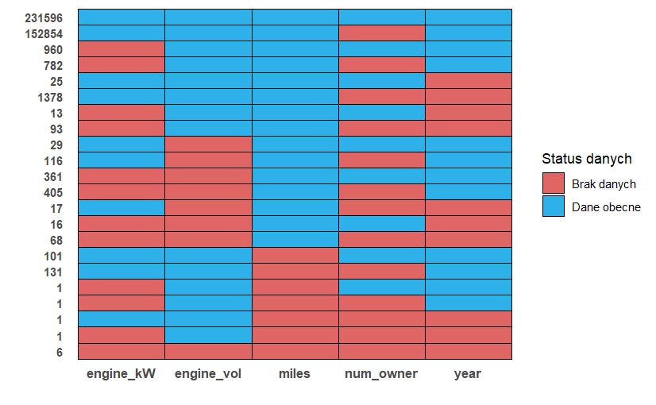

Po usunięciu wybrakowanej kolumny `num_owner`:

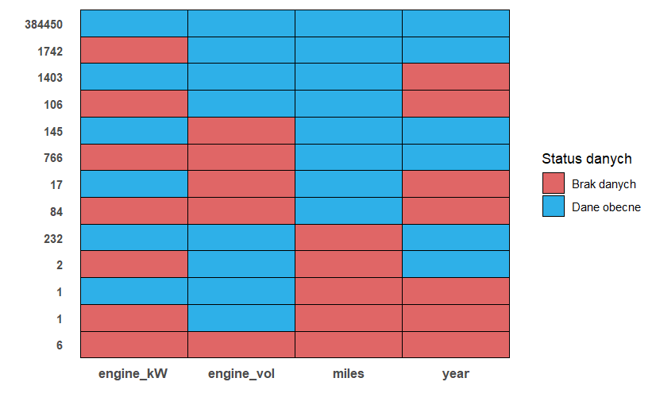

::: callout-note
## Usuwanie braków danych

Ostatecznie ze względu na wielkość zbioru danych oraz znaczną przewagę losowego współwystepowania braków usunięto wszystkie wybrakowane obserwacje, aby nie zaburzać oryginalności danych za pomocą nieopłacalnych technik imputacji.
:::

## Podsumowanie operacji czyszczących dane

| Etap                                | Liczba obserwacji | Usunięte rekordy |
|-------------------------------------|:-----------------:|-----------------:|
| Wczytanie danych                    |      818456       |               0w |
| Eliminacja błędnych wartości        |      818453       |                3 |
| Filtracja dziedzinowa               |      812943       |             5510 |
| Filtracja anomalii wielowymiarowych |      812604       |              339 |
| Usuwanie duplikatów                 |      388955       |           423649 |
| Usuwanie braków danych              |      384103       |             4852 |

# Podział zbioru danych

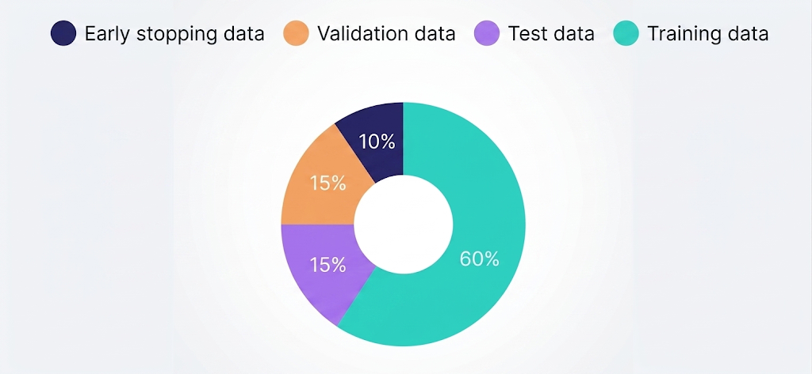

Oczyszczone dane podzielono z wykorzystaniem stratyfikacji względem ceny samochodu `car_price` na zbiory: treningowy, walidacyjny i testowy:

- Zbiór **treningowy**: 70%

  - w tym 10% do early stopping

- Zbiór **walidacyjny**: 15%

- Zbiór **testowy**: 15%

# Wizualizacje na zbiorze treningowym

Czerwona to mediana, niebieska to średnia

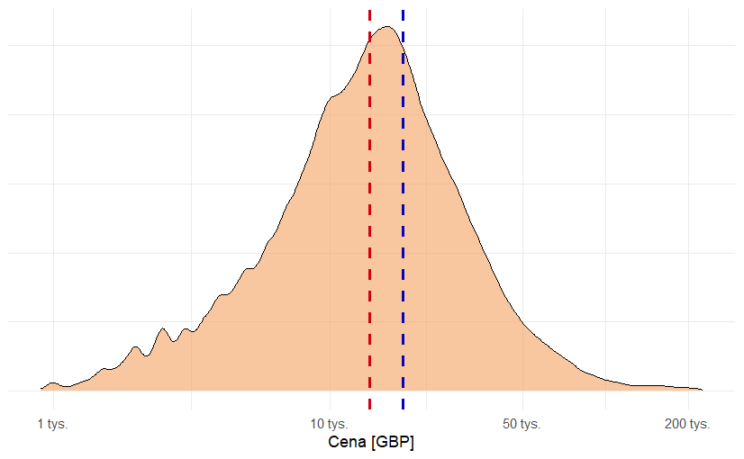

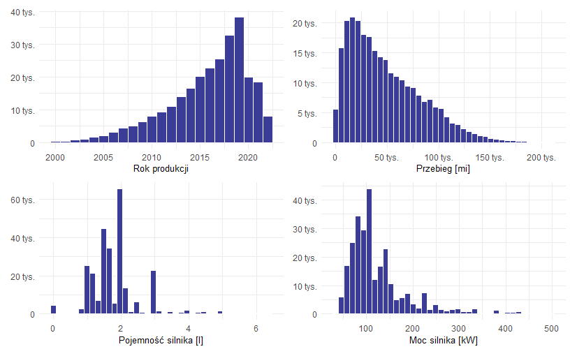

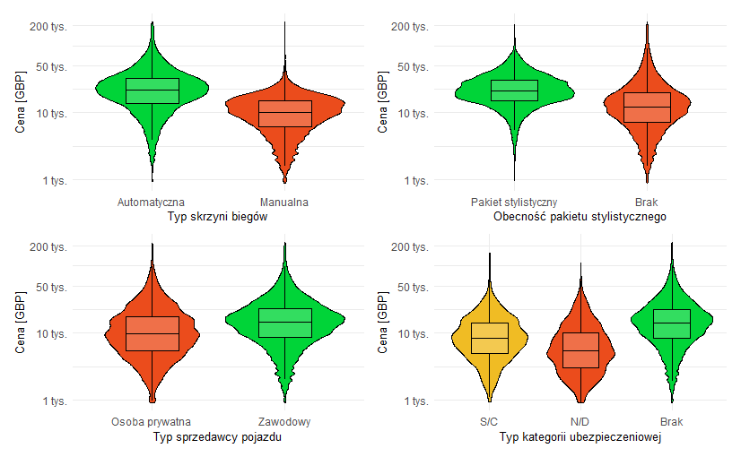

## Korelacje zmiennych numerycznych

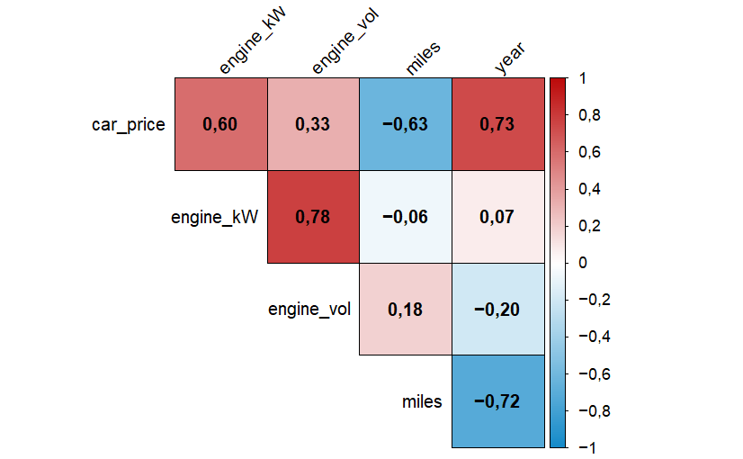

# Budowa modeli

## Regresja liniowa

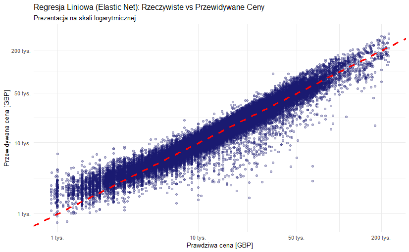

| Zbiór       | R^2^  |  MAE  | RMSE  | MAPE (%) |
|-------------|:-----:|:-----:|:-----:|:--------:|
| Treningowy  | 0,895 | 2 707 | 6 073 |  15,03   |
| Walidacyjny | 0,894 | 2 697 | 6 063 |  14,99   |
| Testowy     | 0,896 | 2 735 | 6 048 |  15,05   |

## Random Forest

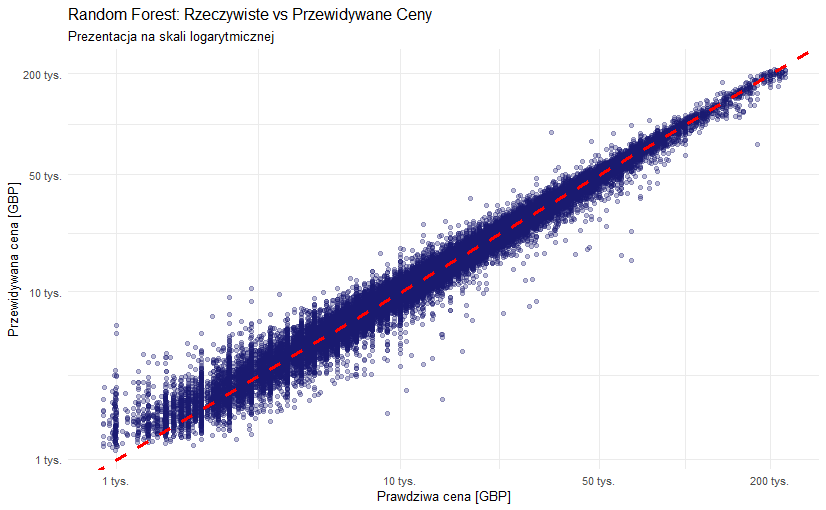

| Zbiór       | R^2^  |  MAE  | RMSE  | MAPE (%) |
|-------------|:-----:|:-----:|:-----:|:--------:|
| Treningowy  | 0,992 |  791  | 1 660 |   5,22   |
| Walidacyjny | 0,978 | 1 217 | 2 644 |   8,21   |
| Testowy     | 0,983 | 1 210 | 2 334 |   8,18   |

## XGBoost

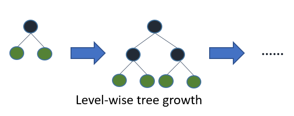

Zródło: <https://lightgbm.readthedocs.io/en/latest/Features.html>

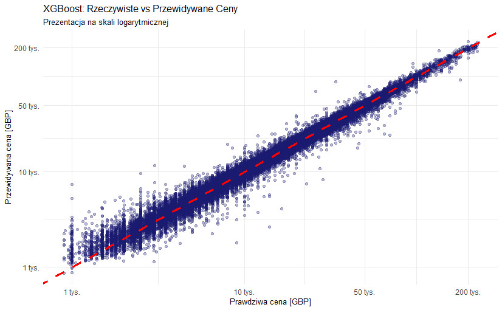

| Zbiór       | R^2^  |  MAE  | RMSE  | MAPE (%) |
|-------------|:-----:|:-----:|:-----:|:--------:|
| Treningowy  | 0,991 |  916  | 1 684 |   5,94   |
| Walidacyjny | 0,980 | 1 139 | 2 544 |   7,44   |
| Testowy     | 0,985 | 1 124 | 2 167 |   7,43   |

## LightGBM

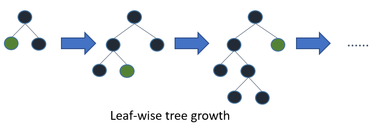

Zródło: <https://lightgbm.readthedocs.io/en/latest/Features.html>

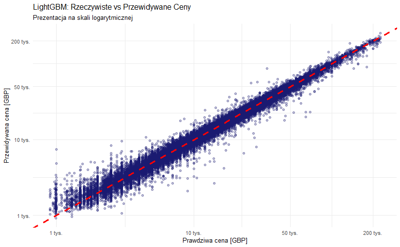

| Zbiór       | R^2^  |  MAE  | RMSE  | MAPE (%) |
|-------------|:-----:|:-----:|:-----:|:--------:|
| Treningowy  | 0,987 | 1 002 | 2 036 |   6,41   |
| Walidacyjny | 0,979 | 1 153 | 2 565 |   7,48   |
| Testowy     | 0,984 | 1 146 | 2 268 |   7,48   |

## CatBoost

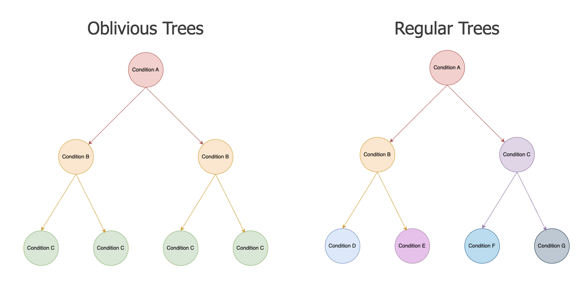

Źródło: <https://towardsdatascience.com/catboost-inner-workings-and-optimizations/>

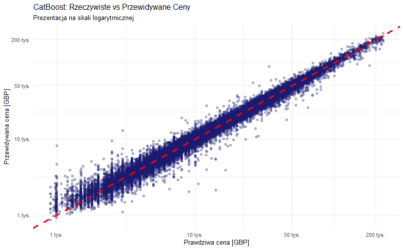

| Zbiór       | R^2^  |  MAE  | RMSE  | MAPE (%) |
|-------------|:-----:|:-----:|:-----:|:--------:|
| Treningowy  | 0,988 | 1030  | 1 985 |   6,50   |
| Walidacyjny | 0,977 | 1 196 | 2 691 |   7,61   |
| Testowy     | 0,983 | 1 187 | 2 366 |   7,62   |

## Sieć neuronowa MLP

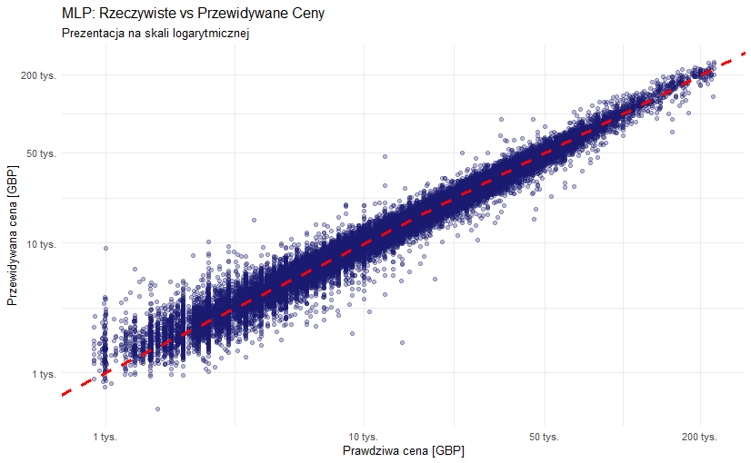

| Zbiór       | R^2^  |  MAE  | RMSE  | MAPE (%) |
|-------------|:-----:|:-----:|:-----:|:--------:|
| Treningowy  | 0,980 | 1 302 | 2 560 |   8,04   |
| Walidacyjny | 0,969 | 1 470 | 3 128 |   9,27   |
| Testowy     | 0,974 | 1 466 | 2 906 |   9,30   |

## Podsumowanie wyników wszystkich modeli na zbiorze testowym

| Model                          |   R^2^    |    MAE    |   RMSE    | MAPE (%) |
|:-------------------------------|:---------:|:---------:|:---------:|:--------:|
| Regresja liniowa (Elastic Net) |   0,896   |   2 735   |   6 048   |  15,05   |
| Random Forest                  |   0,983   |   1 210   |   2 334   |   8,18   |
| **XGBoost**                    | **0,985** | **1 124** | **2 167** | **7,43** |
| LightGBM                       |   0,984   |   1 146   |   2 268   |   7,48   |
| CatBoost                       |   0,983   |   1 187   |   2 366   |   7,62   |
| Sieć neuronowa MLP             |   0,974   |   1 466   |   2 906   |   9,30   |

## Czas tuningu + treningu modeli a skuteczność

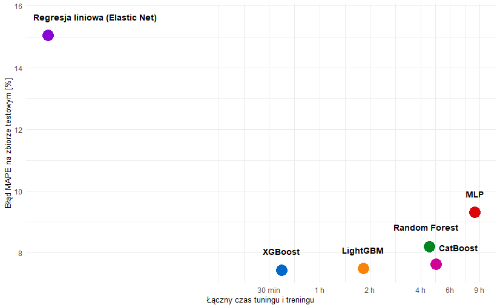

## Analiza błędów predykcyjnych modeli

Podział na 3 grupy cenowe według kwartyla 1 i 3:

- grupa niskich cen

- grupa średnich cen

- grupa wysokich cen

::: {#tbl-tab11}
| **Model** | **R\^2** | MAE | RMSE | MAPE |
|:---|:--:|:--:|:--:|:--:|
| **Grupa niskich cen (do** $Q_1$**)** |  |  |  |  |
| Elastic Net | 0,730 | 831 | 1 105 | 21,09 |
| Random Forest | 0,850 | 579 | 806 | 13,85 |
| XGBoost | 0,876 | 516 | 729 | 12,31 |
| **LightGBM** | **0,877** | **516** | **725** | **12,29** |
| CatBoost | 0,873 | 524 | 737 | 12,42 |
| MLP | 0,825 | 633 | 890 | 15,20 |
| **Grupa średnich cen (od** $Q_1$ **do** $Q_3$**)** |  |  |  |  |
| Elastic Net | 0,729 | 1 735 | 2 365 | 12,05 |
| Random Forest | 0,902 | 904 | 1 273 | 6,44 |
| **XGBoost** | **0,918** | **823** | **1 163** | **5,85** |
| LightGBM | 0,916 | 828 | 1 177 | 5,89 |
| CatBoost | 0,914 | 842 | 1 190 | 5,98 |
| MLP | 0,881 | 1 010 | 1 408 | 7,14 |
| **Grupa wysokich cen (od** $Q_3$**)** |  |  |  |  |
| Elastic Net | 0,806 | 6 629 | 11 564 | 15,03 |
| Random Forest | 0,970 | 2 452 | 4 228 | 6,00 |
| **XGBoost** | **0,973** | **2 331** | **3 939** | **5,72** |
| LightGBM | 0,970 | 2 410 | 4 154 | 5,87 |
| CatBoost | 0,967 | 2 535 | 4 359 | 6,09 |
| MLP | 0,953 | 3 208 | 5 385 | 7,71 |
:::

# Wyjaśnialność modeli

## Wykresy globalne ALE

Wyizolowany wpływ zmiennych numerycznych na średnie prognozowane ceny

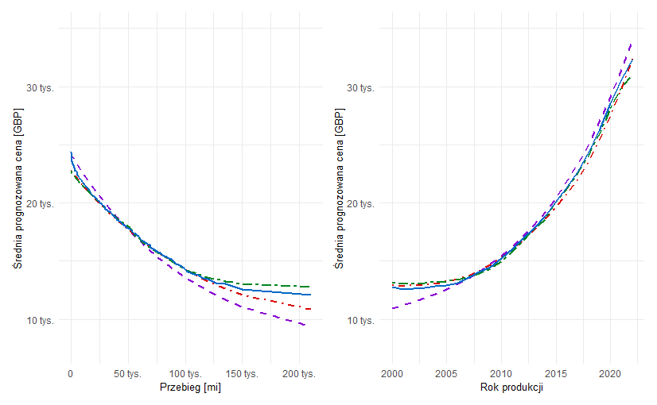


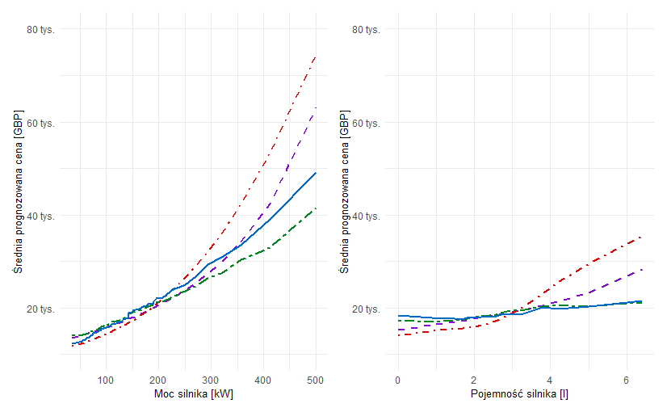


::: callout-note
## Krzywa dla regresji liniowej

Zakrzywiona czerwona linia dla regresji pojawiła się poprzez użycie logarytmu ceny pojazdu podczas uczenia modeli.
:::

# Analiza i wyjaśnialność modelu XGBoost

## Ważność zmiennych

- **Metoda permutacyjna**

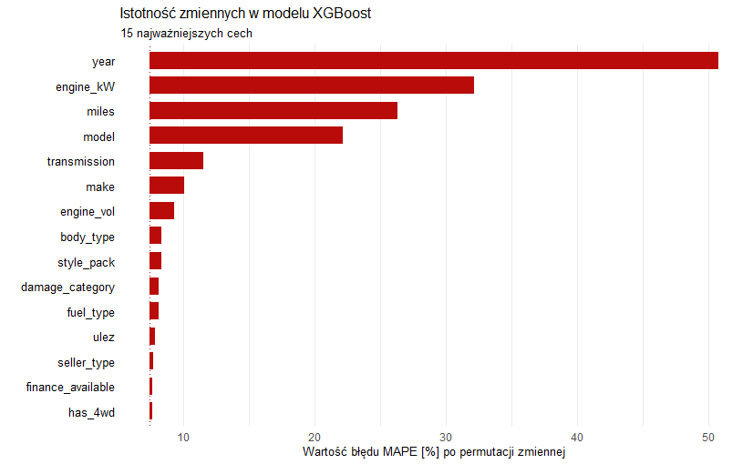

- **Globalny wykres SHAP**

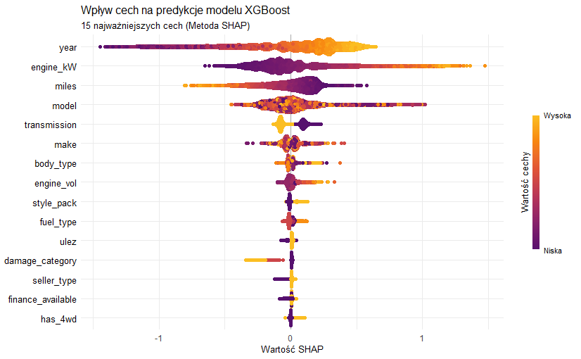

## Lokalna dekompozycja decyzji predykcyjnych

| Cena prawdziwa | Prognoza | Błąd bezwzględny | Błąd względny \[%\] |
|------------------------------:|:------------:|:------------:|:------------:|
| **Obserwacja z najmniejszym błędem prognozy** |  |  |  |
| *Fiat 500, 2016, 18 117 mi, 1,2 l, 51 kW, benzyna* |  |  |  |
| 7 990 | 7 990,06 | 0,06 | 0,00073 |
| **Obserwacja z największym błędem prognozy** |  |  |  |
| *Audi A3, 2008, 11 100 mi, 1,4 l, 92 kW, benzyna* |  |  |  |
| 1 000 | 7 329,12 | 6 329,12 | 632,91184 |

### Breakdown

Analiza wpływu konkretnych zmiennych na predykcje dla tych obserwacji:

- Pojazd o najmniejszym względnym błędzie procentowym

  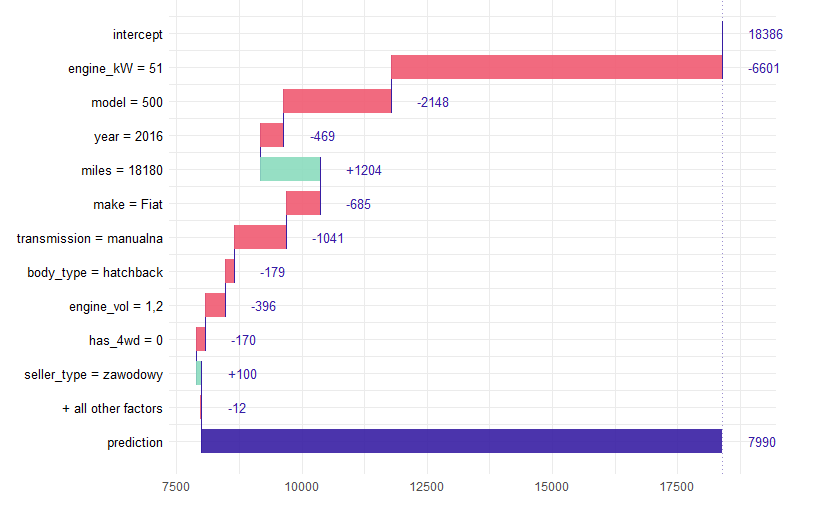

- Pojazd o największym względnym błędzie procentowym

  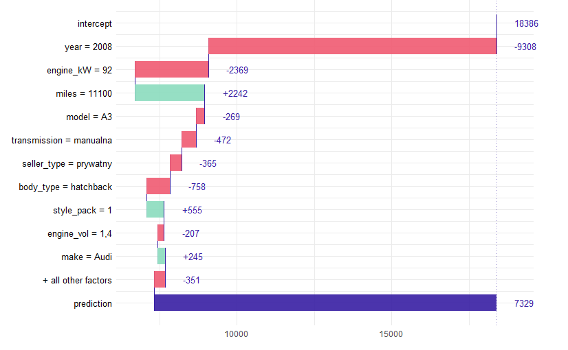

### Ceteris paribus

Wykresy ceteris paribus dla zmiennych numerycznych samochodu o największym błędzie prognozy

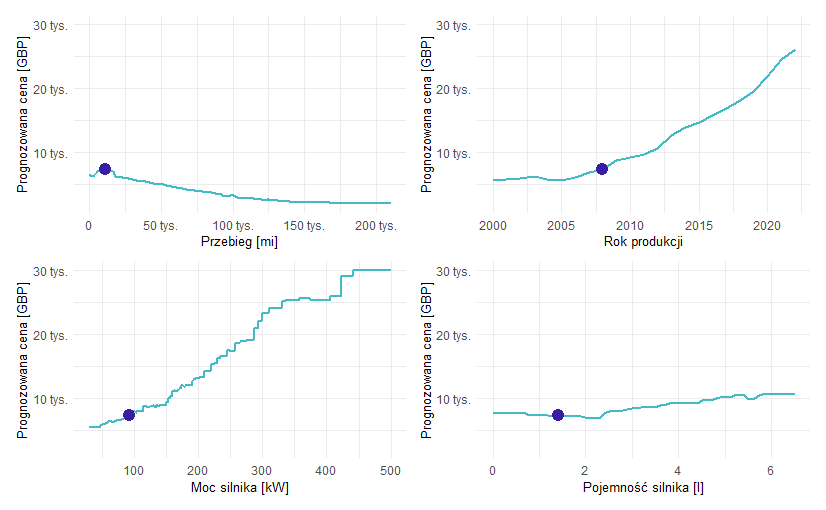

# Wnioski

- Żaden model nie wykazał drastycznego overfittingu (największy dla Random Forest, względem zbioru treningowego, co jest zwyczajną sytuacją)

  - Najlepsze wyniki osiągnął model XGBoost:

    | Zbiór       | R^2^  |  MAE  | RMSE  | MAPE (%) |
    |-------------|:-----:|:-----:|:-----:|:--------:|
    | Treningowy  | 0,991 |  916  | 1 684 |   5,94   |
    | Walidacyjny | 0,980 | 1 139 | 2 544 |   7,44   |
    | Testowy     | 0,985 | 1 124 | 2 167 |   7,43   |

- Pomimo złożoności sieci neuronowej MLP, modele drzewiaste, a szczególnie algorytm XGBoost i reszta modeli boostingowych osiągnęły lepsze wyniki względem każdej branej pod uwagę metryki regresyjnej

- Pomimo ogólnie dość zadowalających metryk na zbiorze testowym wszystkie modele popełniały spore błędy dla pojedynczych obserwacji ze względu na złożoną charakterystykę rynku aut oraz egzemplarze nietypową i takie z potencjalnie błędnymi cenami

# Wdrożenie modelu XGBoost

Aplikacja do prognozowania ceny wybranego przez użytkownika samochodu

*Model: XGBoost, rynek: Wielka Brytania (październik 2022)*

<https://01a19d2f-9688-4218-0bc9-29123eae962b.share.connect.posit.cloud>

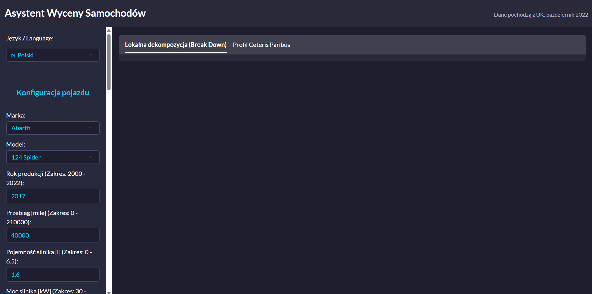

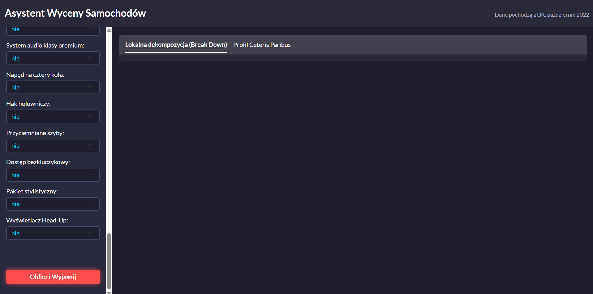

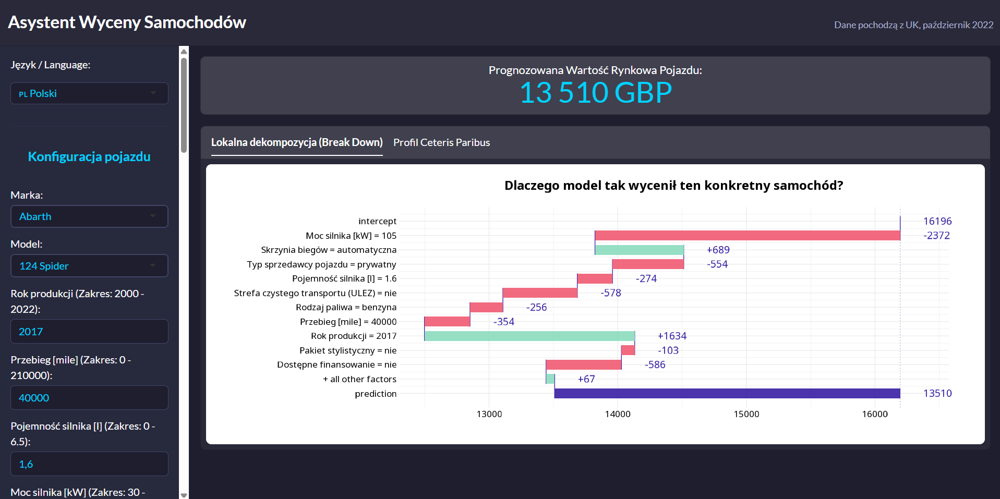

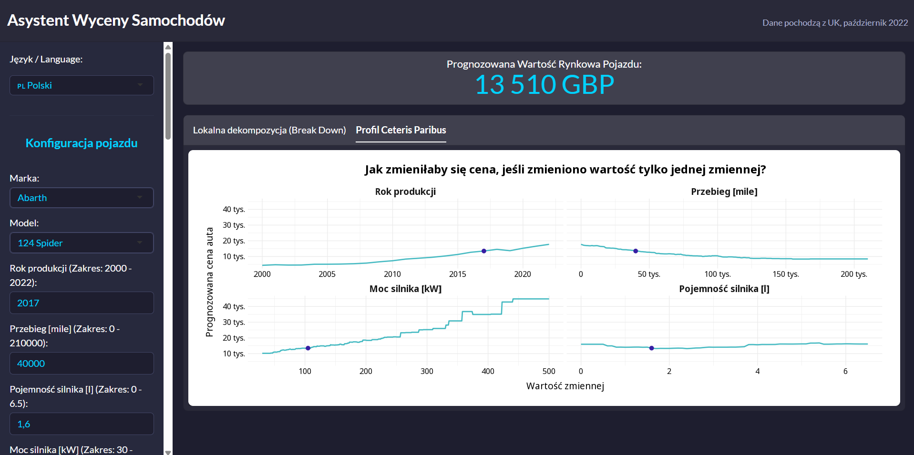
